# SmartGym — Sitemap & Navigation Architecture

Tài liệu kiến trúc thông tin, sơ đồ màn hình, ma trận phân quyền và cấu trúc điều hướng cho SmartGym.
Căn cứ trực tiếp: [design.md](file:///d:/WORKSPACE/Smart-Gym/design.md) (Mục 2 và Mục 6).

---

## 1. Sitemap Tổng thể (Global Sitemap)

Hệ thống SmartGym phục vụ 4 Persona riêng biệt với các đường dẫn URL độc lập:

```mermaid
graph TD
    Root["/ (SmartGym Portal)"]
    
    %% Auth Routes
    Root --> Auth["/auth"]
    Auth --> Login["/auth/login"]
    Auth --> Register["/auth/register"]
    
    %% Kiosk
    Root --> Kiosk["/kiosk (Locked Screen)"]
    Kiosk --> KioskFace["/kiosk/face (Fullscreen Camera)"]
    Kiosk --> KioskQR["/kiosk/qr (Dynamic QR Scan)"]
    Kiosk --> KioskEnroll["/kiosk/enroll (Staff-Assisted)"]
    
    %% Member
    Root --> Member["/app (Member Portal)"]
    Member --> MHome["/app/home (Thẻ & Mật độ)"]
    Member --> MSchedule["/app/schedule (Lịch tập của tôi)"]
    Member --> MBookManual["/app/bookings/manual (Đặt lịch thủ công)"]
    Member --> MBookSmart["/app/bookings/smart (Đặt lịch thông minh CP-SAT)"]
    Member --> MPlans["/app/plans (Mua gói & Gia hạn)"]
    Member --> MOrders["/app/orders (Đơn hàng & Thanh toán)"]
    Member --> MWorkouts["/app/workouts (Giáo án & Kết quả)"]
    Member --> MAttendance["/app/attendance (Lịch sử ra vào)"]
    Member --> MProfile["/app/profile (Mục tiêu & Sinh trắc học)"]
    
    %% PT
    Root --> PT["/trainer (PT Portal)"]
    PT --> PTHome["/trainer/today (Ca dạy hôm nay)"]
    PT --> PTSchedule["/trainer/schedule (Lịch tuần & Ca làm)"]
    PT --> PTLeaves["/trainer/leaves (Xin nghỉ phép)"]
    PT --> PTMembers["/trainer/members (Hội viên phụ trách)"]
    PT --> PTSession["/trainer/sessions/:bookingId (Buổi tập & Chấm công)"]
    PT --> PTPlans["/trainer/workout-plans (Quản lý giáo án)"]
    
    %% Manager
    Root --> Admin["/admin (Manager Dashboard)"]
    Admin --> ADash["/admin/dashboard (Tổng quan & Mật độ)"]
    Admin --> AMembers["/admin/members (Quản lý hội viên & Sinh trắc học)"]
    Admin --> APlans["/admin/plans (Quản lý gói tập)"]
    Admin --> AOrders["/admin/orders (Duyệt thanh toán tiền mặt/CK)"]
    Admin --> ATrainers["/admin/trainers (Hồ sơ PT & Phân ca)"]
    Admin --> ALeaves["/admin/leaves (Duyệt nghỉ phép)"]
    Admin --> ABookings["/admin/bookings (Lịch toàn phòng & Đổi hộ)"]
    Admin --> AAttendance["/admin/attendance (Giám sát ra vào & Sửa phiên)"]
    Admin --> AReports["/admin/reports (Báo cáo doanh thu & Lượt PT)"]
    Admin --> ASettings["/admin/settings (Cấu hình phòng gym)"]
```

---

## 2. Danh mục Chi tiết Màn hình (Screen Inventory)

### 2.1 Nhóm Public / Xác thực
| Mã màn hình | Tên màn hình | Đường dẫn | Chức năng chính |
| :--- | :--- | :--- | :--- |
| **AUTH-01** | Đăng nhập | `/auth/login` | Đăng nhập bằng Email + Mật khẩu cho Quản lý, Hội viên, PT. |
| **AUTH-02** | Đăng ký hội viên | `/auth/register` | Đăng ký tài khoản hội viên mới (kiểm tra trùng email, hướng dẫn đăng nhập). |
| **AUTH-03** | Ghép nối Kiosk | `/auth/kiosk-pair` | Quản lý đăng nhập và cấp quyền cho thiết bị Kiosk tại sảnh. |

### 2.2 Nhóm Kiosk Check-in/Check-out (`/kiosk`)
| Mã màn hình | Tên màn hình | Đường dẫn | Chức năng chính |
| :--- | :--- | :--- | :--- |
| **KIOSK-01** | Nhận diện Khuôn mặt | `/kiosk/face` | Toàn màn hình camera, nhận diện tức thời < 1s, chuyển chế độ VÀO/RA. |
| **KIOSK-02** | Quét Dynamic QR dự phòng | `/kiosk/qr` | Quét mã Dynamic QR 60s từ điện thoại hội viên khi không nhận diện được mặt. |
| **KIOSK-03** | Thông báo Kết quả | `/kiosk/result-modal` | Modal hiển thị tên, trạng thái check-in thành công/từ chối kèm lý do (Hết hạn, Quá sức chứa). |
| **KIOSK-04** | Thu mẫu Sinh trắc học | `/kiosk/enroll` | Nhân viên hỗ trợ thu 3–5 mẫu mặt đạt chuẩn, kiểm tra consent và kiểm tra nghi trùng. |

### 2.3 Nhóm Hội viên (`/app`) — Tối ưu Mobile Web
| Mã màn hình | Tên màn hình | Đường dẫn | Chức năng chính |
| :--- | :--- | :--- | :--- |
| **MEM-01** | Trang chủ Hội viên | `/app/home` | Thẻ hội viên điện tử, số lượt PT còn lại, mật độ phòng hiện tại, nút mở QR check-in nhanh. |
| **MEM-02** | Modal Dynamic QR | `/app/qr-modal` | Sinh mã QR có chữ ký HMAC kèm nonce, thời hạn 60s, tự động tăng độ sáng màn hình. |
| **MEM-03** | Lịch tập của tôi | `/app/schedule` | Lịch dạng tuần/ngày, trạng thái buổi tập, nút Hủy lịch (> 12h hoàn lượt) hoặc Đổi lịch. |
| **MEM-04** | Đặt lịch PT Thủ công | `/app/bookings/manual` | Chọn gói tập -> chọn PT -> chọn ngày -> chọn slot trống 60 phút -> xác nhận giữ 1 lượt. |
| **MEM-05** | Đặt lịch Thông minh CP-SAT | `/app/bookings/smart` | Nhập số buổi/tuần, ngày giờ rảnh, PT ưu tiên -> xem 3 phương án gợi ý -> xác nhận nguyên tử. |
| **MEM-06** | Danh mục Gói tập | `/app/plans` | Xem các gói đang mở bán, giá VND, thời hạn, quyền vào phòng, số buổi PT. |
| **MEM-07** | Đơn hàng & Thanh toán | `/app/orders` | Danh sách đơn hàng, hướng dẫn chuyển khoản (số tài khoản, cú pháp) / nộp tiền mặt tại quầy. |
| **MEM-08** | Giáo án & Kết quả | `/app/workouts` | Xem bài tập do PT soạn, lịch sử mức tạ, số reps đạt được và nhận xét của PT. |
| **MEM-09** | Lịch sử Ra vào | `/app/attendance` | Lịch sử các lần check-in/out tại Kiosk, thời gian tập thực tế. |
| **MEM-10** | Hồ sơ & Quyền riêng tư | `/app/profile` | Cập nhật mục tiêu tập, thời gian rảnh; xem trạng thái khuôn mặt; nút yêu cầu Xóa khuôn mặt. |

### 2.4 Nhóm Huấn luyện viên (`/trainer`)
| Mã màn hình | Tên màn hình | Đường dẫn | Chức năng chính |
| :--- | :--- | :--- | :--- |
| **PT-01** | Ca dạy Hôm nay | `/trainer/today` | Danh sách các slot dạy trong ngày, trạng thái check-in phòng của hội viên, nút Bắt đầu buổi. |
| **PT-02** | Lịch làm việc Tuần | `/trainer/schedule` | Xem toàn bộ ca làm việc (`trainer_shifts`), các slot đã có hội viên đặt, các slot trống. |
| **PT-03** | Đề nghị Nghỉ phép | `/trainer/leaves` | Gửi đơn xin nghỉ phép; xem cảnh báo các lịch bị ảnh hưởng (sẽ chuyển sang `NEEDS_RESCHEDULE`). |
| **PT-04** | Danh sách Hội viên | `/trainer/members` | Danh sách hội viên đang dạy, hồ sơ mục tiêu, gói tập liên quan (không xem thanh toán/mặt). |
| **PT-05** | Thực thi Buổi tập | `/trainer/sessions/:id` | Bắt đầu khi hội viên đã check-in; ghi nhận actual sets, reps, weight; bấm Hoàn thành buổi tập. |
| **PT-06** | Soạn thảo Giáo án | `/trainer/workout-plans` | Tạo giáo án bài tập (tên bài, nhóm cơ, sets, reps, kg, rest); lưu phiên bản mới khi sửa. |

### 2.5 Nhóm Quản trị (`/admin`) — Desktop Workstation
| Mã màn hình | Tên màn hình | Đường dẫn | Chức năng chính |
| :--- | :--- | :--- | :--- |
| **MNG-01** | Dashboard Quản lý | `/admin/dashboard` | Hội viên active, doanh thu thực tế, số phiên mở, lượt PT hoàn thành, biểu đồ mật độ. |
| **MNG-02** | Quản lý Hội viên | `/admin/members` | Bảng dữ liệu hội viên, tìm kiếm, lọc trạng thái, thao tác Khóa / Mở khóa tài khoản. |
| **MNG-03** | Chi tiết Hội viên | `/admin/members/:id` | Hồ sơ, gói tập đang active, số lượt khả dụng, lịch sử giao dịch, thu hồi quyền sinh trắc học. |
| **MNG-04** | Quản lý Gói tập | `/admin/plans` | Tạo mới, chỉnh sửa, ngừng bán gói tập (không sửa hồi tố gói đã bán). |
| **MNG-05** | Quản lý Đơn & Thanh toán | `/admin/orders` | Danh sách đơn chờ duyệt; đối soát tiền mặt/chuyển khoản; Xác nhận (cấp gói) hoặc Từ chối có lý do. |
| **MNG-06** | Quản lý Huấn luyện viên | `/admin/trainers` | Tạo tài khoản PT, cấu hình chuyên môn, phân ca làm việc, giới hạn giờ dạy/ngày. |
| **MNG-07** | Duyệt Nghỉ phép PT | `/admin/leaves` | Duyệt/từ chối đơn nghỉ; hệ thống tự động đổi lịch bị ảnh hưởng sang `NEEDS_RESCHEDULE`. |
| **MNG-08** | Lịch Toàn phòng | `/admin/bookings` | Xem lịch tổng của toàn bộ PT/phòng; tạo, đổi hoặc hủy lịch thay hội viên theo đúng ràng buộc. |
| **MNG-09** | Quản lý Điểm danh | `/admin/attendance` | Danh sách phiên ra vào; công cụ Sửa phiên quên checkout (bắt buộc nhập lý do và audit log). |
| **MNG-10** | Báo cáo & Doanh thu | `/admin/reports` | Doanh thu xác nhận trừ hoàn tiền, thống kê hiệu suất ca PT, lịch sử mật độ cao điểm. |
| **MNG-11** | Cấu hình Hệ thống | `/admin/settings` | Cấu hình giờ mở cửa, sức chứa tối đa, giờ hủy hoàn lượt (12h), số buổi PT song song tối đa. |

---

## 3. Ma trận Phân quyền Màn hình (RBAC Screen Access Matrix)

Hệ thống kiểm soát nghiêm ngặt bằng Role-Based Access Control:

| Nhóm màn hình | Manager | Member | Trainer | Kiosk Appliance | Ghi chú bảo mật |
| :--- | :---: | :---: | :---: | :---: | :--- |
| **Xác thực chung (`/auth/*`)** | ✓ | ✓ | ✓ | ✓ | Đăng nhập công khai |
| **Kiosk Điểm danh (`/kiosk/*`)** | ✓ | ✗ | ✗ | **✓ (Chính)** | Kiosk được cấp API Token riêng |
| **Kiosk Thu mẫu khuôn mặt** | **✓ (Bắt buộc)**| ✗ | ✗ | ✗ | Bắt buộc có nhân viên xác minh danh tính |
| **Trang chủ Hội viên (`/app/*`)** | ✗ | **✓ (Chính)** | ✗ | ✗ | Chỉ xem dữ liệu cá nhân của chính mình |
| **Mua gói & Thanh toán cá nhân** | ✗ | ✓ | ✗ | ✗ | Thành viên tự tạo đơn |
| **Đặt lịch (Thủ công / CP-SAT)** | ✗ | ✓ | ✗ | ✗ | Chỉ đặt trên gói tập còn lượt khả dụng |
| **Ca dạy & Lịch tuần PT (`/trainer/*`)**| ✗ | ✗ | **✓ (Chính)** | ✗ | Chỉ xem ca dạy của mình và học viên mình dạy |
| **Chấm công & Ghi giáo án** | ✗ | ✗ | ✓ | ✗ | Chỉ thực hiện khi học viên đã check-in phòng |
| **Dashboard Quản trị (`/admin/*`)** | **✓ (Chính)** | ✗ | ✗ | ✗ | Toàn quyền quản trị |
| **Duyệt thanh toán / Hoàn tiền** | ✓ | ✗ | ✗ | ✗ | Không cho phép PT hoặc Member can thiệp |
| **Sửa phiên điểm danh thủ công** | ✓ | ✗ | ✗ | ✗ | Yêu cầu lý do và lưu vào `audit_logs` |
| **Xem vector khuôn mặt / Raw frame**| **CẤM** | **CẤM** | **CẤM** | **CẤM** | **Tuyệt đối không bên nào được xem** |

---

## 4. Cấu trúc Điều hướng (Navigation Patterns)

### 4.1 Manager Web Navigation (Desktop Persistent Sidebar)
- **Vị trí**: Cố định bên trái màn hình (`w-[240px]`), nền trắng (`#FFFFFF`), phân tách với nội dung bằng đường kẻ viền phải 1px (`#E5E7EB`).
- **Cấu trúc nhóm menu**:
  - **TỔNG QUAN**: Dashboard (`/admin/dashboard`)
  - **NGHIỆP VỤ HỘI VIÊN**: Hội viên (`/admin/members`), Đơn hàng & Thanh toán (`/admin/orders`), Gói tập (`/admin/plans`)
  - **VẬN HÀNH & LỊCH**: Lịch toàn phòng (`/admin/bookings`), Huấn luyện viên (`/admin/trainers`), Duyệt nghỉ phép (`/admin/leaves`)
  - **KIỂM SOÁT PHÒNG TẬP**: Điểm danh & Kiosk (`/admin/attendance`), Báo cáo (`/admin/reports`), Cấu hình (`/admin/settings`)
- **Top Bar Header (Chiều cao 64px)**:
  - Nền trắng (`#FFFFFF`), đường viền dưới 1px (`#E5E7EB`).
  - Hiển thị Mật độ phòng tập hiện tại dạng real-time: `Mật độ: 32/60 (53%) [Ổn định]`.
  - Chuông thông báo (đơn hàng mới, yêu cầu nghỉ phép mới).
  - Avatar quản lý + Dropdown đăng xuất.

### 4.2 Member Mobile Web Navigation (Mobile-First Bottom Bar + Header)
- **Top Sticky Header (Chiều cao 64px)**:
  - Nền trắng (`#FFFFFF`), logo SmartGym bên trái.
  - Bên phải: Nút hiển thị nhanh **Mã Dynamic QR** (màu xanh lá đậm `#087A3E`) và Chuông thông báo.
- **Bottom Navigation Bar (Cố định đáy màn hình, 4 mục, touch target 48px, nền trắng)**:
  1. **Trang chủ**: Thẻ điện tử, mật độ phòng, buổi tập kế tiếp.
  2. **Lịch tập**: Lịch tuần cá nhân, nút Đặt lịch (+).
  3. **Gói tập**: Xem gói, mua gói, trạng thái đơn hàng.
  4. **Tài khoản**: Hồ sơ, giáo án, cài đặt khuôn mặt, lịch sử ra vào.

### 4.3 Trainer Navigation (Responsive Adaptive)
- **Desktop/Tablet**: Sidebar trắng thu gọn (`w-[240px]`).
- **Mobile**: Bottom bar 3 tab: `Hôm nay (Ca dạy)` | `Lịch tuần` | `Hội viên & Giáo án`.

### 4.4 Kiosk Navigation (Professional Light Appliance UI)
- **Không có thanh điều hướng web**: Toàn bộ thanh địa chỉ, footer, sidebar đều bị ẩn.
- **Header Kiosk (Chiều cao 64px, nền trắng viền dưới #E5E7EB)**:
  - Góc trái: Logo SmartGym + Đồng hồ điện tử chuẩn thời gian thực.
  - Giữa: Mật độ phòng hiện tại (`Số người đang tập: 28 / 60`).
  - Góc phải: Nút chuyển chế độ **[ VÀO (IN) ]** / **[ RA (OUT) ]** to rõ (kích thước nút 56px, màu xanh lá đậm `#087A3E`).
- **Footer Kiosk**:
  - Nút phụ: `[ Quét mã QR trên điện thoại ]` (kích thước 48px, nền trắng viền xanh lá đậm `#087A3E`).
  - Dòng hướng dẫn: *"Vui lòng đứng thẳng, nhìn thẳng vào camera trong 1 giây"*.
