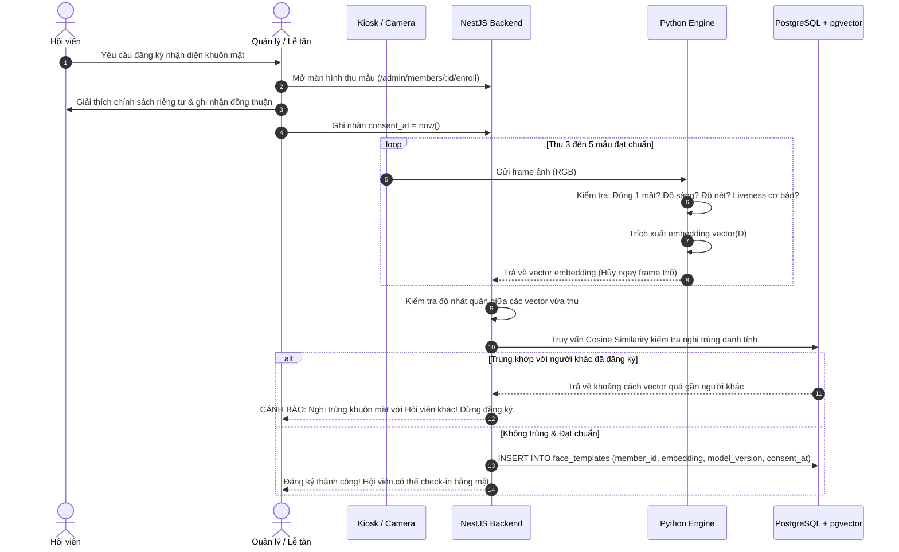
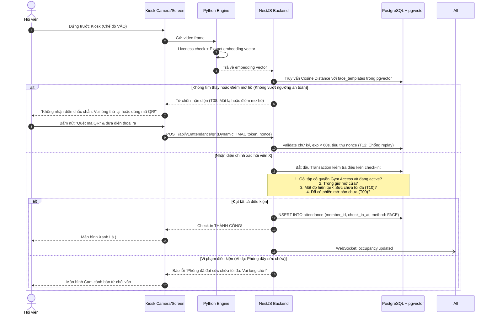
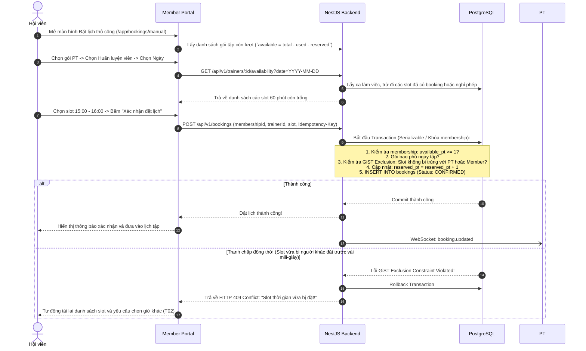

# SmartGym — User Flows & Interaction Specifications

Tài liệu đặc tả các luồng người dùng (User Flows), điều kiện tiên quyết, các bước thao tác, luồng rẽ nhánh và cơ chế xử lý ngoại lệ cho hệ thống SmartGym.
Căn cứ trực tiếp: [design.md](file:///d:/WORKSPACE/Smart-Gym/design.md) (Mục 2, 5, 7, 8, 9, 13).

---

## 1. Flow 1: Mua Gói tập, Đối soát Thanh toán & Kích hoạt Thẻ (Member & Manager)

```mermaid
sequenceDiagram
    autonumber
    actor M as Hội viên (Member)
    participant UI as Member Portal
    participant API as NestJS Backend
    participant DB as PostgreSQL
    actor A as Quản lý (Manager)

    M->>UI: Xem danh sách gói tập (/app/plans)
    M->>UI: Chọn gói & Bấm "Tạo đơn mua"
    UI->>API: POST /api/v1/orders (planId, method: CASH|TRANSFER)
    API->>DB: Tạo Order (Status: PENDING, Snapshot quyền lợi & giá VND)
    API-->>UI: Trả về đơn hàng & Thông tin thanh toán
    UI-->>M: Hiển thị hướng dẫn chuyển khoản (STK, Cú pháp) hoặc nộp tiền quầy

    Note over M,A: Hội viên chuyển khoản hoặc nộp tiền mặt tại quầy
    A->>API: Xem danh sách đơn chờ (/admin/orders)
    alt Đối soát khớp số tiền
        A->>API: POST /api/v1/orders/:id/confirm (Idempotency-Key)
        API->>DB: Transaction: Order -> CONFIRMED; Tạo Membership (SCHEDULED/ACTIVE)
        Note right of DB: T01: Xác nhận 2 lần chỉ tạo 1 Membership (Idempotent)
        API-->>A: Xác nhận thành công
        API-)M: WebSocket: order.confirmed (Thông báo cập nhật thẻ tập)
    else Sai lệch tiền hoặc hủy
        A->>API: POST /api/v1/orders/:id/reject (Lý do từ chối)
        API->>DB: Order -> REJECTED
        API-->>A: Đã từ chối đơn
    end
```

### Xử lý Ngoại lệ & Ràng buộc:
- **Gói ngừng bán**: Vẫn hiển thị quyền lợi với người đã mua trước đó; người mới không thể tạo đơn cho gói này.
- **Xác nhận lặp (Idempotency)**: Nếu Quản lý click nút "Xác nhận" 2 lần do mạng lag, server kiểm tra `idempotency_keys` và trạng thái `orders.status == CONFIRMED` -> trả về kết quả cũ, tuyệt đối không tạo bản ghi Membership thứ hai.
- **Hoàn tiền (Refund)**: Quản lý thực hiện giao dịch hoàn tiền -> Hệ thống kiểm tra xem có booking PT nào trong tương lai không; nếu có thì cảnh báo giải quyết booking trước khi thu hồi thẻ.

---

## 2. Flow 2: Đăng ký Thu mẫu Sinh trắc học Khuôn mặt (Kiosk Enrollment)



### Xử lý Ngoại lệ:
- **Nhiều khuôn mặt trong khung hình**: Kiosk phát âm thanh báo *"Chỉ 1 người đứng trước camera"*.
- **Ảnh mờ / Quá tối**: Yêu cầu đứng lại đúng vạch hướng dẫn.
- **Hội viên rút lại quyền (Xóa mặt)**: Hội viên hoặc Quản lý gọi `DELETE /api/v1/members/:id/face` -> Hard delete bản ghi trong `face_templates`. Kiosk từ chối nhận diện ngay lập tức (**Acceptance Test T15**).

---

## 3. Flow 3: Check-in Điểm danh tại Kiosk (Face & Dynamic QR Fallback)



### Xử lý Ngoại lệ Check-out:
- **Hết hạn gói trong lúc đang tập**: Hội viên vào phòng lúc 21:30 (gói hết hạn lúc 22:00), check-out lúc 22:30 -> Hệ thống **vẫn cho phép check-out thành công** bình thường (**Acceptance Test T11**).
- **Quét liên tục nhiều lần**: Partial unique index chặn việc tạo thêm phiên mở thứ 2 (**Acceptance Test T09**).

---

## 4. Flow 4: Đặt lịch PT Thủ công (Manual 1-1 Booking)



---

## 5. Flow 5: Đặt lịch Thông minh bằng OR-Tools CP-SAT (Smart Scheduling)

```mermaid
sequenceDiagram
    autonumber
    actor M as Hội viên
    participant UI as Member Portal
    participant API as NestJS Backend
    participant Solver as Python CP-SAT Engine
    participant DB as PostgreSQL

    M->>UI: Mở công cụ Đặt lịch thông minh (/app/bookings/smart)
    M->>UI: Nhập: 3 buổi/tuần, Khung giờ rảnh (Thứ 2-4-6, 17h-20h), Ưu tiên PT A, Đổi PT nếu cần
    UI->>API: POST /api/v1/bookings/suggest (payload ràng buộc)
    API->>DB: Lấy ca làm PT, các slot khả dụng, lịch sử tập, giới hạn giờ
    API->>Solver: Gửi ma trận biến nhị phân x[p,t] và trọng số ưu tiên
    Solver->>Solver: Chạy tối ưu 2 giai đoạn (Max buổi -> Max điểm ưu tiên, timeout <= 2.5s)
    Solver-->>API: Trả về 3 phương án gợi ý (Phương án 1, 2, 3)
    API-->>UI: Trả về 3 phương án cho hội viên so sánh (KHÔNG KHÓA CHỖ TRƯỚC)

    M->>UI: Xem xét và chọn "Phương án 1" -> Bấm "Xác nhận cả tuần"
    UI->>API: POST /api/v1/bookings/confirm-plan (danh sách slot của phương án, Idempotency-Key)
    API->>DB: Bắt đầu 1 Transaction duy nhất cho toàn bộ phương án:
    Note over API,DB: Kiểm tra lại toàn bộ ràng buộc thời gian thực cho từng slot
    alt Toàn bộ các slot đều hợp lệ
        API->>DB: INSERT các bản ghi bookings; Cập nhật reserved_pt = reserved_pt + 3
        DB-->>API: Commit thành công
        API-->>UI: Đặt lịch thành công trọn gói cả tuần!
    else Có 1 slot bị người khác chiếm mất trong lúc đang suy nghĩ (T06)
        DB-->>API: Xung đột slot!
        API->>DB: ROLLBACK TOÀN BỘ (Không xác nhận dở dang)
        API-->>UI: Báo lỗi 409: "Một trong các slot đã bị đặt. Vui lòng tính lại phương án!"
        UI-->>M: Yêu cầu bấm tính toán lại phương án mới
    end
```

---

## 6. Flow 6: Quản lý Ca dạy & Thực hiện Buổi tập (Trainer)

```mermaid
sequenceDiagram
    autonumber
    actor PT as Huấn luyện viên
    actor M as Hội viên
    participant UI as PT Screen
    participant API as NestJS Backend
    participant DB as PostgreSQL

    M->>API: Check-in vào phòng tập tại Kiosk
    API->>DB: Tạo phiên attendance (Status: OPEN)
    
    PT->>UI: Mở ca dạy hôm nay (/trainer/today)
    UI->>API: Kiểm tra trạng thái học viên
    API-->>UI: Hội viên Nguyễn Văn A: ĐÃ CHECK-IN PHÒNG TẬP (Sẵn sàng)
    
    PT->>UI: Bấm "Bắt đầu buổi tập"
    UI->>API: POST /api/v1/bookings/:id/start
    API->>DB: Booking -> IN_PROGRESS
    
    Note over PT,M: Hai người tiến hành tập luyện theo giáo án
    PT->>UI: Nhập kết quả bài tập (Actual Sets, Reps, Tạ kg, Ghi chú)
    PT->>UI: Bấm "Hoàn thành buổi tập" (Idempotency-Key)
    UI->>API: POST /api/v1/bookings/:id/complete
    API->>DB: Transaction: Booking -> COMPLETED; Cập nhật: reserved_pt - 1, used_pt + 1
    API->>DB: Lưu workout_results
    DB-->>API: Commit
    API-->>UI: Buổi tập hoàn tất! Trừ lượt tập thành công.
```

### Xử lý Ngoại lệ Hội viên Vắng mặt (No-Show):
- Sau thời gian chờ cấu hình (ví dụ: quá 20 phút mà hội viên không check-in phòng và không báo):
- PT bấm "Báo vắng mặt (No-show)" -> Booking chuyển `NO_SHOW` -> Lượt tập chuyển từ `reserved` thành `used` (không hoàn lượt theo chính sách).

---

## 7. Flow 7: PT Xin Nghỉ phép & Tự động Bảo lưu Lịch (Trainer Leave Request)

1. PT gửi đơn xin nghỉ ca chiều thứ 5 trên màn hình `/trainer/leaves`.
2. Hệ thống quét thấy có 2 buổi tập đã được hội viên đặt trước trong khung giờ này.
3. Hệ thống cảnh báo rõ ràng cho PT: *"Có 2 lịch tập của Hội viên Nguyễn Văn A và Trần Văn B sẽ bị ảnh hưởng"*.
4. PT xác nhận gửi đơn -> Trạng thái đơn: `PENDING`.
5. Quản lý nhận thông báo trên Dashboard -> Bấm "Duyệt nghỉ phép":
   - **Xử lý tự động trong Transaction (Acceptance Test T07)**:
     - Tạo bản ghi `leave_requests (Status: APPROVED)`.
     - Cập nhật 2 lịch booking sang trạng thái: `NEEDS_RESCHEDULE`.
     - Giải phóng khung giờ (không còn chiếm slot của PT nữa).
     - **Giữ nguyên số lượt tập khả dụng của hội viên** (không trừ lượt, không hủy bỏ quyền lợi).
     - Gửi thông báo WebSocket / Web Notification cho 2 hội viên: *"Buổi tập của bạn lúc 15:00 ngày Thứ 5 cần được sắp xếp lại do PT có việc đột xuất. Số lượt tập của bạn vẫn được bảo lưu trọn vẹn"*.
